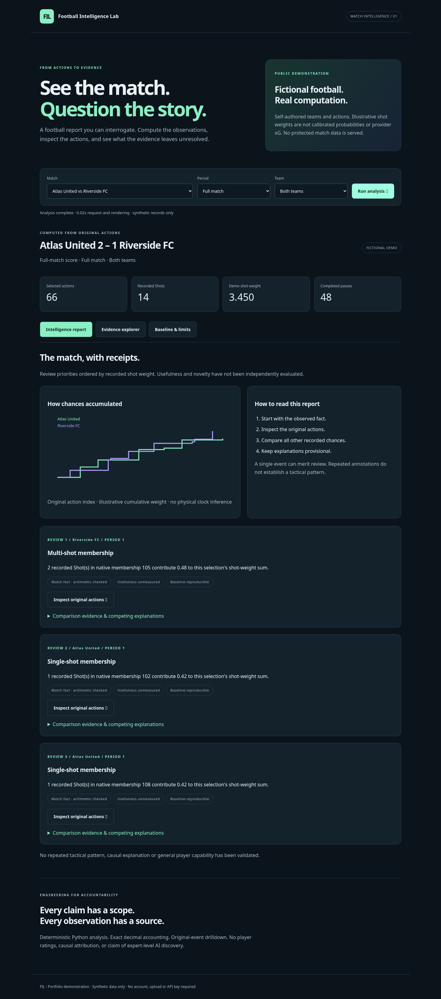
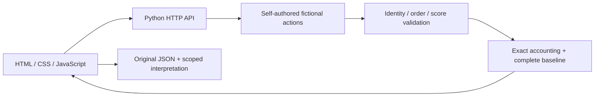

# FIL · Match Intelligence

[](https://github.com/Qiao527/fil-match-intelligence/actions/workflows/ci.yml)

Built by [Qiao527](https://github.com/Qiao527).

[Production application](https://fil-match-intelligence.vercel.app) ·
[90-second demo](docs/DEMO.md) · [Verification scope](docs/VERIFICATION.md)

**A full-stack football match review application where every observation leads back to evidence.**

Select a fictional match → compute its report → inspect original actions → compare the baseline.
The public application runs a Python API and a responsive browser frontend. It requires no account,
API key, dataset download, database or runtime third-party dependency.



## Run locally

Requires Python **3.12**. From the repository root:

```bash
python serve.py
```

Open **http://127.0.0.1:8650**. Choose a match and click **Run analysis**.
This local server is for development; production uses Vercel's managed Python Functions and HTTPS.

## What works

- Three self-authored fictional match inputs and reports computed on demand.
- Team/period filters, cumulative shot-weight chart and complete comparison baseline.
- Exact original action IDs and JSON drilldown; whole-sequence and comparison-action inspection.
- Scope-aware observations, alternative explanations and no-Shot abstention.
- Request cancellation and stale-response protection during rapid selection changes.
- Responsive desktop/mobile layout, keyboard controls and accessible status announcements.
- Strict API input boundary: no real-match acquisition, user uploads or arbitrary file lookup.

## What makes it technically interesting

The backend uses exact decimal accounting, validates source order and score reconciliation, and
retains every original record. The frontend never manufactures a report or passes protected data
to a model. Every displayed review card has source actions, a full comparison population and
explicit interpretation limits. The fact that a number is correct does not establish football
usefulness, causality or a stable player capability.

The public runtime uses **only the Python standard library**. It is a deliberately small extraction
from a larger FIL research prototype, retaining the necessary deterministic computation and scoring
primitives without its provider-acquisition adapters, private research modules or dataset history.
This repository has a fresh public history; it is not a publication of the private research corpus.

## Architecture



| Endpoint | Behavior |
|---|---|
| `GET /api/health` | Service health and synthetic-only mode |
| `GET /api/matches` | Fixed supported fictional match catalog |
| `GET /api/analyze?match=demo-1` | Live analysis, original actions and match metadata |
| Optional `period=1` or `2`, `team=901` or `902` | Shared report selection |

Unsupported/repeated parameters, real match IDs and invalid selections return HTTP 400.
The service has no POST/upload API. Responses are JSON with no-store caching; production headers
include a restrictive content security policy, MIME sniffing protection and restricted device access.

## Scientific limits

**All public football data is fictional.** Shot weights are hand-authored demonstration values,
not StatsBomb xG or calibrated probabilities. Provider-shaped field names exercise the adapter
contract; they do not indicate that provider records are present.

This is deterministic analysis, not an LLM, trained action-value model or autonomous expert.
Review priorities are ordered by recorded weight, not validated importance or novelty. The complete
ledger baseline can reproduce the facts. Independent analyst usefulness is unmeasured. No tactical
intent, physical direction, tracking, causal contribution, player rating or general ability is inferred.

## Verify

Development-only dependencies are pinned and locked in `pyproject.toml` / `uv.lock` (uv 0.12.23):

```bash
uv sync --frozen
uv run --frozen ruff check .
uv run --frozen pytest -q
uv run --frozen python -m playwright install chromium
uv run --frozen python tests/browser_check.py
```

See [verification and release notes](docs/VERIFICATION.md) for actual outcomes and limitations.
GitHub Actions runs lint and tests on pushes and pull requests with read-only repository permissions.
[90-second demonstration](docs/DEMO.md) · [mobile screenshot](docs/images/mobile.png).

## Portfolio discussion

Built a responsive frontend and Python API for reproducible match review; implemented exact
arithmetic, source-level drilldown, scope-aware claims, strict synthetic-only inputs and regression
coverage. Extracted a minimal public runtime from a larger research prototype without publishing
protected datasets. No model-training or validated scientific-discovery achievement is claimed.

Code: [MIT](LICENSE). No provider dataset, credentials or private research artifacts are included.

[Deployment guide](docs/DEPLOYMENT.md) · Production URL will be added only after live verification.
